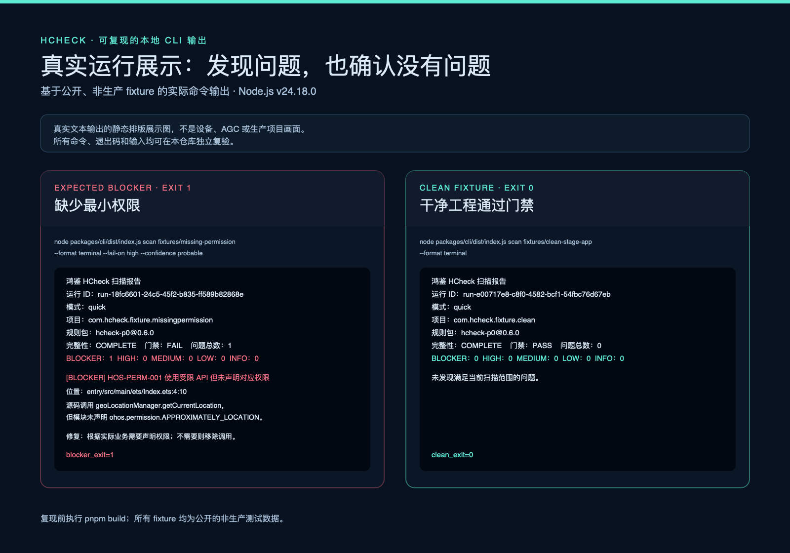

# HCheck

[中文](README.md) · [Docs](docs/00-文档导航.md) · [Contributing](CONTRIBUTING.md) · [Security](SECURITY.md)

> A local-first, evidence-driven CLI for pre-release inspection of HarmonyOS applications.

Right before release, the most costly misses are often outside business code: undeclared permissions, mismatched versions, a Debug artifact, a leftover test endpoint, or dependencies that disagree with privacy disclosure. HCheck checks deterministic cases locally and returns the location, rule, remediation direction, and reproducible result.

> Core principle: report what can be established; never turn missing evidence into a pass.

## When to use it

- Before a handoff or release, to inspect HarmonyOS project configuration, permissions, versions, and dependencies.
- When you have an APP, HAP, HSP, or HAR and need a read-only view of its metadata, permissions, and Debug markers.
- When your team needs the same traceable result in the terminal and CI instead of screenshots and verbal confirmation.
- When a finding needs to remain understandable and reproducible after the first person has fixed it.

## Start in three minutes

Requirements: Node.js `24.18.0` and pnpm `10.34.0`.

```bash
git clone https://github.com/dososo/HarmonyOS-HCheck.git
cd HarmonyOS-HCheck
corepack enable
pnpm install --frozen-lockfile
pnpm build

# Run the included clean fixture first; it should report PASS.
pnpm hcheck scan fixtures/clean-stage-app --format terminal
```

Then replace the directory with your own HarmonyOS project. Use the second command for a local package:

```bash
pnpm hcheck scan <your-project-directory> --format terminal
pnpm hcheck package inspect <local-hap-or-app-path> --format terminal
```

Start with a project copy or a non-production artifact. Never commit production signing material, real user data, or unredacted logs to this repository, an issue, or a report.

## What you get

1. **Project checks** for Stage configuration, `app.json5`, `module.json5`, `build-profile.json5`, and `oh-package` dependencies: placeholders, test endpoints, minimum permissions, Bundle/version consistency, Debug markers, and local SDK disclosure.
2. **Package checks** that read local APP, HAP, HSP, and HAR metadata, permissions, Debug markers, and parse completeness without writing to them.
3. **Clear findings** with severity, confidence, applicability, a rule ID, location, and remediation clue.
4. **Reusable results** in Terminal, JSON, SARIF, JUnit, HTML, and Agent JSON for local use, CI, and later audit.

## Real output example



The image is a rendering of real CLI output from this repository's public fixtures. The missing-permission fixture returns `exit 1` with `HOS-PERM-001`; the clean fixture returns `exit 0`. Reproduce it with:

```bash
pnpm hcheck scan fixtures/missing-permission --format terminal --fail-on high --confidence probable
pnpm hcheck scan fixtures/clean-stage-app --format terminal
```

## What it does not do

- It does not replace HarmonyOS or AppGallery Connect review and does not guarantee approval or publication.
- It does not upload source code, perform device write actions by default, or read or distribute production signing material.
- It does not treat page scraping, reverse-engineered interfaces, or implicit login as a product capability.
- It never reports unimplemented work, incomplete evidence, or an unavailable external service as a pass.

Version `0.6.0` is a development baseline: `quick` scanning and local package inspection are implemented. Device, external-tool, and AGC-related capabilities remain explicit, constrained adapter boundaries; they are not a substitute for a formal release decision.

## FAQ

**Will it modify my project?** No. Local checks are read-only by default. The repair path only produces an explicit, auditable dry-run plan.

**Do I need a physical device or an AGC login?** No. Project scanning and local package inspection can run offline. Device and external-service workflows require separate configuration and explicit human approval.

**Is this an official Huawei tool?** No. It is an independent community project. Confirm any conclusion against the target SDK, device, official documentation, and actual runtime result.

## Learn more and contribute

- [CLI commands, configuration, and exit codes](docs/04-CLI与配置规范.md)
- [Rules and rule development](docs/05-规则体系与开发规范.md)
- [Runtime evidence and device boundaries](docs/06-运行时验证与证据.md)
- [Security and data handling](docs/11-安全隐私与凭证.md)
- [Contributing](CONTRIBUTING.md) · [Code of Conduct](CODE_OF_CONDUCT.md) · [Security policy](SECURITY.md)

## About the author

HCheck is independently created and maintained by 爆裂队长NEXT (BLCaptain). It is an independent, unofficial open-source project that turns HarmonyOS application configuration, dependencies, package metadata, and verification evidence into a reproducible, auditable pre-release inspection system for AI agents and engineering teams.

- GitHub: [@dososo](https://github.com/dososo)
- X / Twitter: [@thinkszyg](https://x.com/thinkszyg)
- Email: blteam2026@outlook.com
- Maintainer of an open-source catalogue of traditional Chinese patterns: [wenyang.net](https://wenyang.net)

If this project helps you, please star or share it, or reach out on X.

## License

Released under the [MIT License](LICENSE). HarmonyOS, OpenHarmony, ArkUI, Huawei, and related names and trademarks belong to their respective owners.
