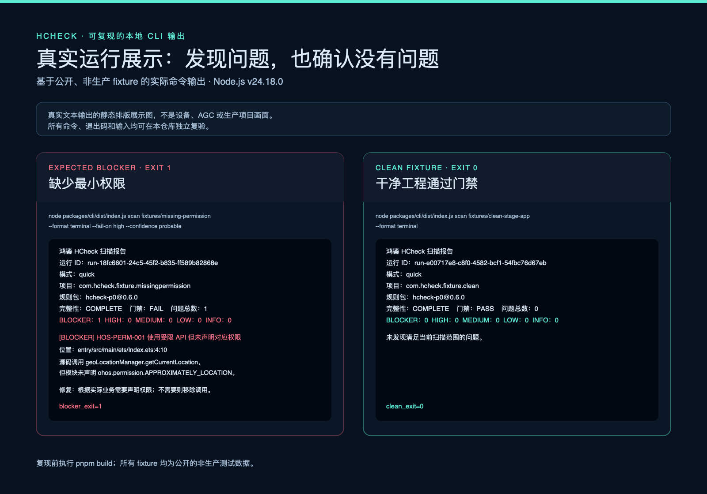
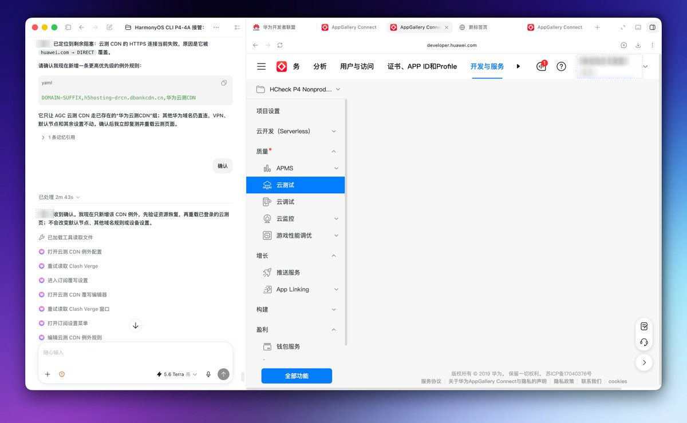
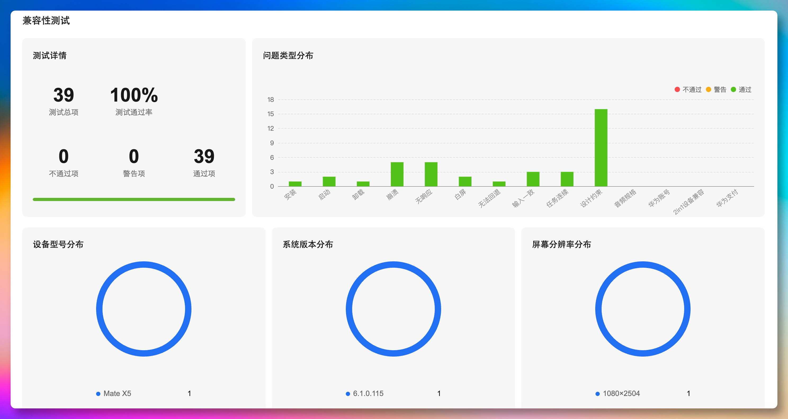

# 鸿鉴 HCheck

[English](README.en.md) · [安全报告](SECURITY.md) · [贡献](CONTRIBUTING.md) · [许可证](LICENSE) · [文档](docs/00-文档导航.md)

> 面向 HarmonyOS 应用的本地优先、证据驱动的发布前审查 CLI。

鸿鉴 HCheck 将工程配置、依赖、软件包、规则与验证证据组织为可复现的检查结果，帮助开发团队在提交前更早发现可确定的问题，并给出可审计的修复与复验线索。

## 解决什么问题

- 将 HarmonyOS 工程配置、权限、依赖和软件包元数据放进同一套确定性检查流程；
- 用严重性、置信度与适用性三轴表达风险，避免把猜测包装成结论；
- 输出 Terminal、JSON、SARIF、JUnit、HTML 与 Agent JSON，便于本地开发与 CI 消费；
- 默认本地、只读、脱敏，不把外部工具或服务失败误判为“通过”。

## 当前能力

- 读取 Stage 工程、`app.json5`、`module.json5`、`build-profile.json5` 与 `oh-package` 依赖信息；
- 执行可配置的 `quick` 规则扫描，覆盖占位元数据、本地测试端点、最小权限、Bundle/版本一致性、Debug 产物标记及本地 SDK 披露一致性等已实现规则；
- 受限只读检查本地 APP、HAP、HSP、HAR 软件包，输出元数据、权限、Debug 标记与解析完整性；
- 生成稳定的 Finding、基线、抑制项与多种报告格式；
- 提供外部工具、AGC、设备与运行时证据的端口/适配器边界。默认 CLI 不会任意执行设备写操作或上传源码。

## 不做什么

- 不替代 HarmonyOS 或 AppGallery Connect 的审核，不保证应用通过审核或上架；
- 不包含生产签名材料、真实用户数据、真实账号、真实设备日志或生产 API 凭据；
- 不以网页抓取、逆向接口或隐式登录作为稳定产品能力；
- 不把未实现、证据不完整或外部服务不可用的情况降级为通过。

## 快速开始

要求：Node.js `24.18.0`、pnpm `10.34.0`。

```bash
corepack enable
corepack install
pnpm install --frozen-lockfile
pnpm check

pnpm build
node packages/cli/dist/index.js doctor fixtures/clean-stage-app --format json
node packages/cli/dist/index.js scan fixtures/missing-permission --format terminal
node packages/cli/dist/index.js package inspect <本地-HAP-或-APP-路径> --format json
```

`fixtures/` 中全部输入都是公开、非生产的测试样例。将命令指向自己的工程或软件包前，请先阅读 [安全与数据处理说明](docs/11-安全隐私与凭证.md)。

## 可复现的真实输出



上图基于本仓库公开 fixture 的实际 CLI 输出排版：左侧命令返回 `exit 1`，并报告 `HOS-PERM-001`；右侧命令返回 `exit 0`，且没有 Finding。它是对真实文本输出的静态展示图，不是终端、设备或 AGC 截图；可查看 [输出源文件](docs/assets/real-run-output.html)，或直接运行以下命令独立复验：

```bash
pnpm build
node packages/cli/dist/index.js scan fixtures/missing-permission --format terminal --fail-on high --confidence probable
node packages/cli/dist/index.js scan fixtures/clean-stage-app --format terminal
```

## 非生产外部环境验证记录

为保持证据边界，以下截图记录发布流程中在非生产 AppGallery Connect 项目内使用官方云测服务的环境操作与结果。它们不是 HCheck CLI 的扫描输出，也不代表华为或 AppGallery Connect 对本项目的背书；图中账号信息已打码。

### 云测入口与连通性预检

<p align="center">
  
</p>

在非生产项目中进入“云测试”服务前，先完成仅限指定华为云 CDN 域名的连通性排查与恢复，再打开对应的官方服务入口。该记录说明外部环境曾被明确预检；它不包含源码上传、生产账号、生产签名材料或设备写操作。

### 兼容性测试汇总

<p align="center">
  
</p>

该次非生产兼容性测试展示了 39 个测试总项、100% 通过率、0 个不通过项和 0 个警告项；页面同时记录目标设备为 Mate X5、系统版本为 6.1.0.115、分辨率为 1080×2504。这仅描述该次测试记录，不外推为所有设备、版本或后续构建均已通过。

## 工作方式

```text
工程与软件包输入
        ↓
确定性规则与受限解析
        ↓
Finding（严重性 / 置信度 / 适用性）
        ↓
终端、CI 与可审计报告
```

完整架构、CLI 契约、规则与证据边界见 [文档导航](docs/00-文档导航.md)。

## 开源协作

- 代码采用 [MIT License](LICENSE)；
- 提交问题与改动前请阅读 [贡献指南](CONTRIBUTING.md)、[行为准则](CODE_OF_CONDUCT.md) 和 [安全政策](SECURITY.md)；
- 本仓库当前只发布源码，不发布 npm 包；各工作区保留 `private: true`，以避免误发布。

## 发布前说明

请在公开仓库设置 About 时使用 [ABOUT.md](ABOUT.md) 中的中英文描述与 Topics。每次发布前都应运行 `pnpm check`、`pnpm security:deps`，审查依赖许可证与公开差异；具体步骤见 [发布范围与检查](docs/10-验收与质量标准.md)。

## 关于作者

鸿鉴 HCheck 由爆裂队长NEXT（BLCaptain）独立创作与维护——一个独立、非官方的开源项目，专注把 HarmonyOS 应用工程的配置、依赖、软件包与验证证据，沉淀为面向 AI Agent 与工程团队的、可复现且可审计的发布前检查系统。

- GitHub：[@dososo](https://github.com/dososo)
- X / Twitter：[@thinkszyg](https://x.com/thinkszyg)
- 邮箱：blteam2026@outlook.com
- 开源中国传统纹样图录项目维护者：[wenyang.net](https://wenyang.net)

如果这个项目对你有帮助，欢迎 Star、分享，或在 X 上 @我交流。

HarmonyOS、OpenHarmony、ArkUI、华为及相关名称和商标归各自权利人所有。检查结论应结合目标 SDK、设备、官方文档和实际运行结果核验。
