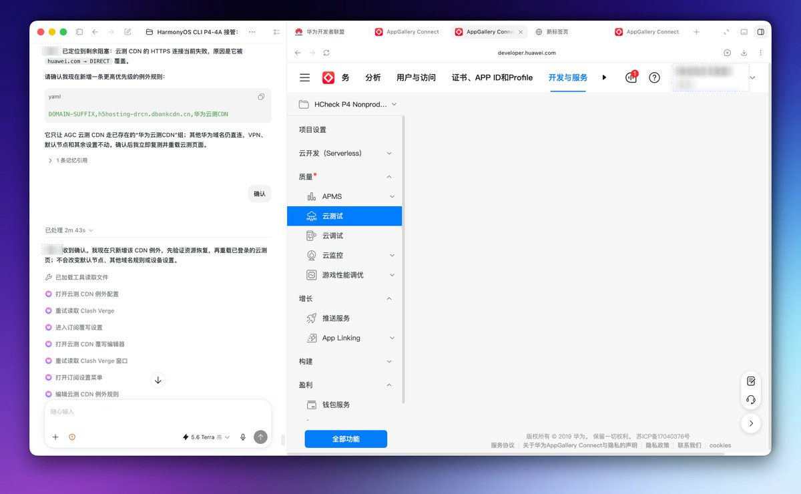
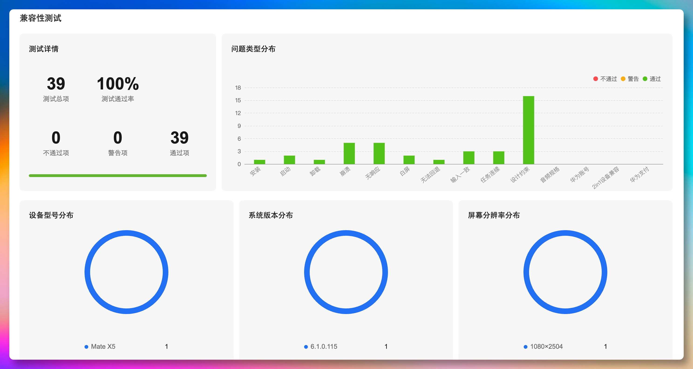

# 非生产外部验证记录

本页保存一次已脱敏的 AppGallery Connect 官方云测旁证，目的是说明项目曾在非生产环境中完成过外部服务流程验证。它不是 HCheck CLI 的扫描输出，也不代表华为、HarmonyOS 或 AppGallery Connect 对本项目的背书、审核结论或上架承诺。

## 记录范围

- 环境：非生产 AppGallery Connect 项目；
- 数据：截图中的账号信息已脱敏，不包含生产签名材料、真实用户数据、生产令牌或可复用凭据；
- 结论范围：仅描述截图所示的一次服务记录，不能外推到其他设备、系统版本、构建产物或未来版本；
- 能力边界：HCheck 当前可复现的是本地工程与软件包检查；设备、外部工具和 AGC 相关能力是显式、受限的适配器边界，不能替代正式发布裁决。

## 云测入口与连通性预检

  

该截图记录在打开非生产项目的官方云测试服务前，对指定服务入口完成连通性预检后进入“云测试”页面的过程。它只说明当时外部环境可访问对应服务；不包含源码上传、生产账号、生产签名材料或设备写操作。

## 兼容性测试汇总

  

截图页面记录了该次非生产兼容性测试的 39 个测试项、100% 通过率、0 个不通过项和 0 个警告项，并显示了当次目标设备、系统版本与分辨率。它仅是该次运行的历史旁证：不能据此推断所有设备都通过，也不能据此确认后续构建仍然通过。

## 如何正确使用这份记录

将它作为“曾完成一次受控外部验证”的背景资料，而不是产品功能演示或质量保证。对当前代码，请优先运行仓库公开 fixture 的本地命令；对自己的应用，请在自己的非生产环境、目标设备和目标 SDK 上重新执行官方流程并保留脱敏证据。

不要将本页截图中的信息与真实账号、签名材料、未脱敏日志、生产软件包或用户数据一起提交到仓库、Issue 或报告中。
